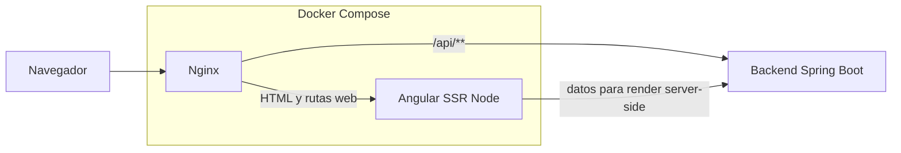
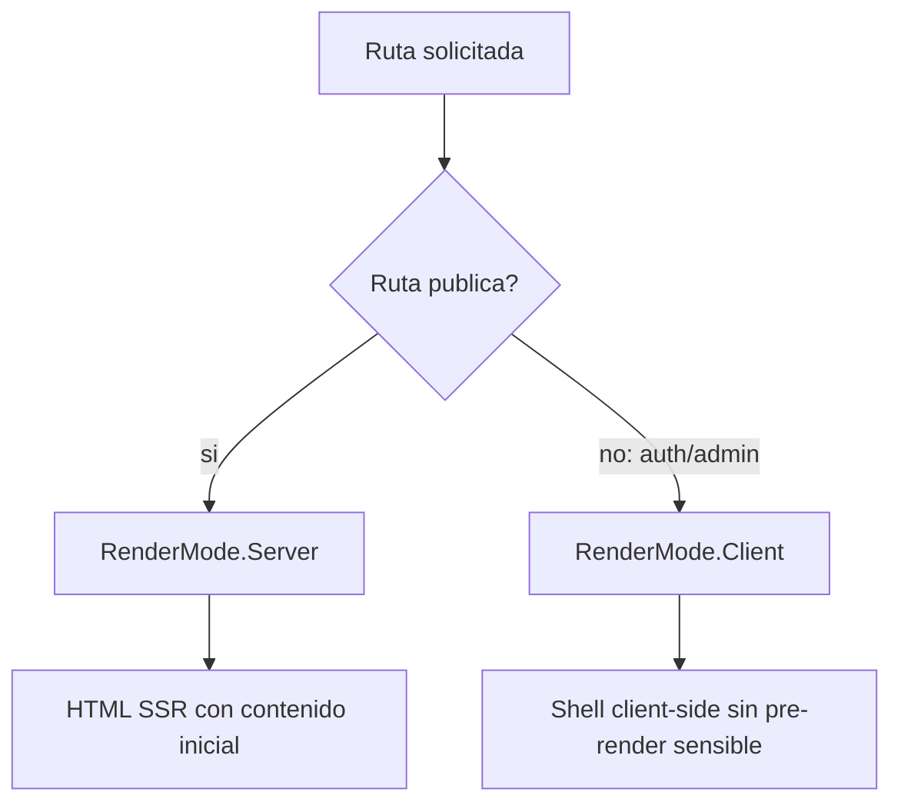
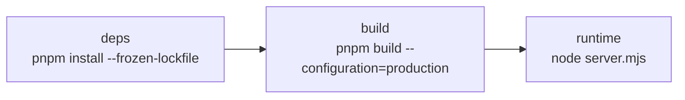

# Arquitectura SSR De Produccion

Este documento describe la arquitectura SSR vigente del frontend SISMO. La guia operativa paso a paso esta en `docs/DESPLIEGUE.md`.

## Decision

El frontend ya no se publica como SPA estatica servida directamente por Nginx. La build usa Angular SSR y se ejecuta con Node.js.

| Aspecto | Implementacion vigente |
|---|---|
| Build | `@angular/build:application` con `outputMode: "server"` |
| Runtime | `node:24.16.0-alpine` |
| Proceso web | `node dist/sismo-frontend/server/server.mjs` |
| Puerto SSR | `4000` |
| Proxy publico | Nginx |
| API navegador | Same-origin `/api/**` |
| API SSR | `SSR_API_URL` |

## Topologia



## Renderizado Por Ruta

La politica vive en `src/app/routing/server-render-policy.ts`.



Rutas server-side:

- `/`
- `/sismos`
- `/historial`
- `/estaciones`
- `/consultas`

Rutas client-side:

- `/acceso`
- `/recuperar-acceso`
- `/cambiar-contrasena`
- `/repositorio`
- `/profile`
- `/umbrales-estaciones`

La separacion reduce exposicion de informacion sensible y evita renderizar formularios de autenticacion o vistas administrativas en servidor.

## API En SSR

`environment.prod.ts` usa `apiUrl: ''` para que el navegador llame al mismo origen. En servidor, `ApiService` resuelve `baseUrl` asi:

```typescript
if (isPlatformBrowser(inject(PLATFORM_ID))) {
  this.baseUrl = environment.apiUrl;
} else {
  this.baseUrl = process.env['SSR_API_URL'] ?? 'http://localhost:8080';
}
```

Esto evita llamadas relativas desde Node.js, donde `fetch('/api/...')` no es una URL valida.

## Dockerfile

La imagen tiene tres etapas:



Etapa runtime:

- Base: `node:24.16.0-alpine`.
- Copia `dist/sismo-frontend`.
- Expone `4000`.
- Healthcheck HTTP contra `127.0.0.1:4000`.

## Nginx

Nginx no sirve `index.html` directamente. Reenvia:

| Ruta | Destino |
|---|---|
| `/api/**` | Backend `app:8080` |
| `/actuator/**` | Backend, restringido a red interna |
| `/**` | Angular SSR `frontend:4000` |

Se omite CSP en cabecera Nginx porque Angular genera CSP con `autoCsp` en build.

## Seguridad

- `server_tokens off`.
- `X-Frame-Options: SAMEORIGIN`.
- `X-Content-Type-Options: nosniff`.
- `Referrer-Policy: strict-origin-when-cross-origin`.
- `Permissions-Policy` restrictiva.
- Bloqueo de archivos ocultos via `location ~ /\.`.
- Rutas administrativas en `RenderMode.Client`.
- `AdminGuard` protege rutas privadas.

## Allowed Hosts

Angular SSR valida hosts permitidos. En produccion se debe agregar el dominio final en `angular.json`:

```json
"security": {
  "allowedHosts": ["localhost", "sismologia.ice.go.cr"]
}
```

## Verificacion Rapida

```bash
pnpm check
pnpm smoke:ssr:maps
docker build -t sismo-frontend:ci .
docker compose up -d --build
curl -i http://localhost:4200/
```

## Riesgos Conocidos

| Riesgo | Mitigacion |
|---|---|
| Uso accidental de `window`/`document` en SSR | Proteger con `isPlatformBrowser` |
| Backend no resoluble desde SSR | Configurar `SSR_API_URL` |
| Dominio final no autorizado | Actualizar `security.allowedHosts` |
| Mezcla de Node versions | Usar `.node-version` y pnpm reproducible |
| Rutas sensibles renderizadas en servidor | Mantener `AUTH_ROUTE_PATHS` y `ADMIN_ROUTE_PATHS` en client mode |
