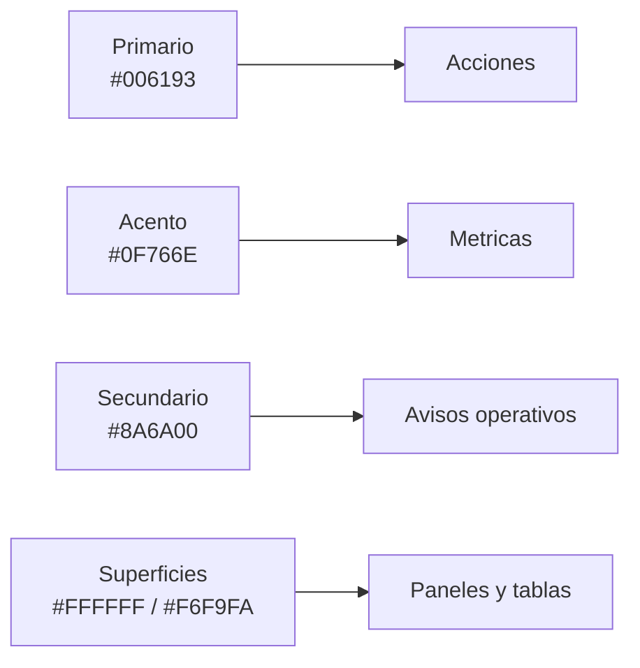
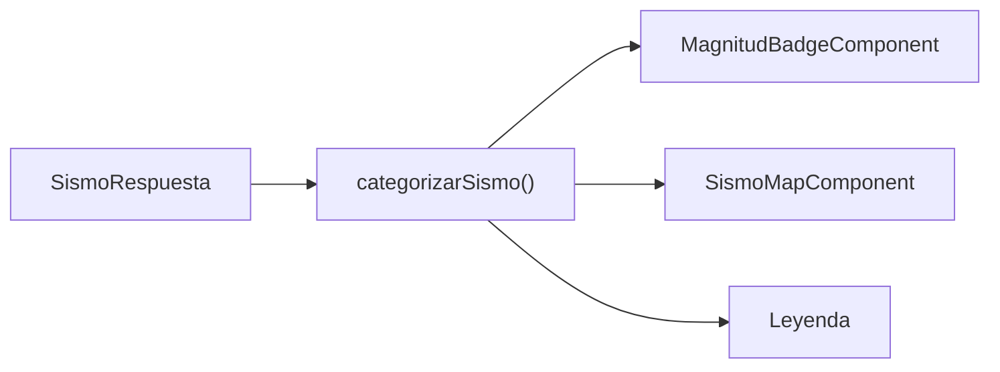
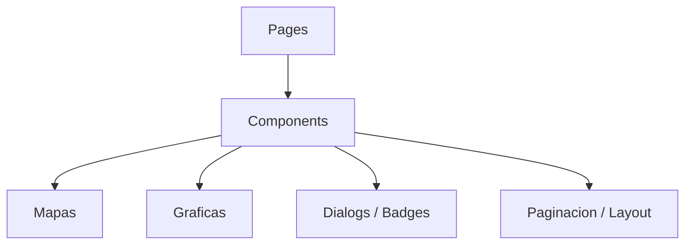

# Sistema De Diseno SISMO Frontend

Guia visual y tecnica para mantener consistencia en vistas, componentes y estilos del frontend SISMO.

## Principios

- Interfaz institucional, tecnica y clara.
- Prioridad a lectura de datos, filtros, tablas, mapas y acciones repetidas.
- Mobile-first, pero optimizado para uso operativo en escritorio.
- Sin estilos inline; preferir utilidades Tailwind y tokens definidos en `src/styles.css`.
- Animaciones sutiles y respetuosas de `prefers-reduced-motion`.

## Stack Visual

| Area | Implementacion |
|---|---|
| Framework UI | Angular standalone |
| Estilos | Tailwind CSS 4 |
| Tokens | `@theme` en `src/styles.css` |
| Iconos | `lucide-angular` |
| Mapas | Leaflet |
| Graficas | Chart.js |
| Fuente | Aptos, Inter, Segoe UI, sans-serif |

## Tokens Principales

Los tokens viven en `src/styles.css`.

| Rol | Token | Valor | Uso |
|---|---|---|---|
| Primario | `--color-primary` | `#006193` | CTAs, enlaces, foco institucional |
| Primario oscuro | `--color-primary-container` | `#075985` | Fondos densos y estados activos |
| Secundario | `--color-secondary` | `#8A6A00` | Enfasis operativo |
| Acento | `--color-accent` | `#0F766E` | Indicadores tecnicos |
| Fondo | `--color-background` | `#F3F7F8` | Fondo de pagina |
| Superficie | `--color-surface` | `#FFFFFF` | Paneles y tarjetas |
| Superficie baja | `--color-surface-container-low` | `#F6F9FA` | Bandas y tablas |
| Texto principal | `--color-text-primary` | `#172026` | Titulos y contenido |



## Magnitud Sismica

Usar `categorizarSismo()` desde `src/app/utils/sismo-criterios.ts`. No duplicar reglas de magnitud o distancia en componentes.

| Nivel | Color | Uso |
|---|---|---|
| 1 | `#22c55e` | Evento bajo |
| 2 | `#eab308` | Evento moderado |
| 3 | `#f97316` | Evento alto |
| 4 | `#ef4444` | Evento critico |
| Sin criterio | `#94a3b8` | Evento no clasificado |



## Tipografia

- Familia: `Aptos`, `Inter`, `Segoe UI`, `sans-serif`.
- Titulos: `font-bold` o `font-semibold`.
- Texto de soporte: `text-sm` o `text-xs`.
- Evitar escalas hero en paneles densos.
- Mantener lectura clara en tablas y filtros.

| Uso | Clases recomendadas |
|---|---|
| Titulo de pagina | `text-2xl sm:text-3xl font-bold` |
| Titulo de seccion | `text-lg font-semibold` |
| Texto base | `text-sm sm:text-base` |
| Metadata | `text-xs font-medium` |
| Etiquetas compactas | `text-xs font-semibold uppercase tracking-wide` |

## Layout

Patron base:

```html
<section class="px-4 py-8 sm:px-6 lg:px-8">
  <div class="mx-auto max-w-7xl">
    ...
  </div>
</section>
```

Reglas:

- Usar `max-w-7xl mx-auto` para contenido principal.
- Usar `grid` para comparacion de datos y `flex` para barras de acciones.
- Mantener filtros cerca de la tabla o mapa que afectan.
- No anidar tarjetas dentro de tarjetas.
- Las secciones de pagina deben ser layouts, no tarjetas flotantes.

## Componentes Base

| Componente | Uso |
|---|---|
| `ButtonComponent` | Acciones principales reutilizables |
| `ConfirmDialogComponent` | Confirmacion destructiva o irreversible |
| `SismoMapComponent` | Mapa principal de eventos y estaciones |
| `EstacionMiniMapComponent` | Mapa compacto por estacion |
| `ScatterChartComponent` | Graficas de dispersion |
| `PaginacionComponent` | Navegacion de listas paginadas |
| `MagnitudBadgeComponent` | Clasificacion por magnitud |
| `StatusBadgeComponent` | Estado operativo de estacion |
| `StatCardComponent` | Indicadores de resumen |



## Estados Visuales

| Estado | Color recomendado |
|---|---|
| Exito | `green-500`, `green-600` |
| Advertencia | `yellow-500`, `amber-600` |
| Error/destructivo | `rose-600`, `rose-700` |
| Informacion | `sky-600` o `--color-primary` |
| Deshabilitado | `slate-400`, `surface-container` |

Mensajes de error deben explicar la accion correctiva cuando sea posible.

## Formularios

- Labels visibles.
- Inputs con foco claro.
- Botones principales al final del flujo.
- Errores cerca del campo o del bloque afectado.
- Deshabilitar botones durante `guardando`, `cargando` o `eliminando`.

## Tablas Y Datos

- Usar numeros tabulares cuando se comparan magnitudes, distancias o fechas.
- Mantener columnas de accion compactas.
- Mostrar estados vacios con `app-empty-state`.
- Evitar truncar datos criticos sin alternativa visible.

## Mapas

- Leaflet solo debe inicializarse en navegador.
- Mostrar fallback mientras el mapa no esta listo.
- Mantener leyenda visible cuando el color codifica severidad.
- No crear reglas nuevas de color fuera de `sismo-criterios.ts`.

## Accesibilidad

- Botones icon-only requieren `aria-label`.
- Modales deben declarar `role="dialog"` y `aria-modal="true"`.
- Estados dinamicos importantes deben ser comprensibles sin color.
- Mantener foco visible.
- Respetar `prefers-reduced-motion`.

## Convenciones Angular

- Componentes standalone.
- `ChangeDetectionStrategy.OnPush`.
- Estado local con `signal()` y `computed()`.
- Side effects con `effect()` cuando haya dependencia reactiva real.
- Servicios con `async/await` sobre `ApiService`.
- DTOs en `src/app/interfaces/api.interfaces.ts`.

## Checklist UI Para Entrega

- [ ] Usa tokens de `src/styles.css`.
- [ ] No usa estilos inline.
- [ ] Es responsive desde mobile.
- [ ] Tiene estados de carga, vacio y error.
- [ ] Los botones icon-only tienen `aria-label`.
- [ ] Las tablas mantienen datos criticos legibles.
- [ ] Los mapas no ejecutan Leaflet en SSR.
- [ ] Los colores de magnitud vienen de `categorizarSismo()`.
- [ ] `pnpm check` pasa.
