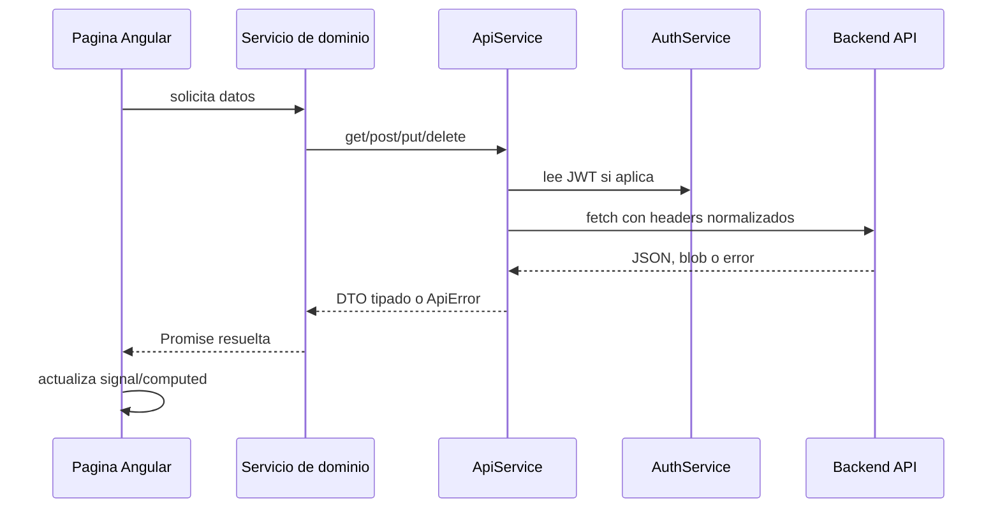
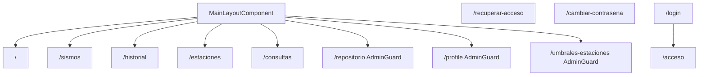
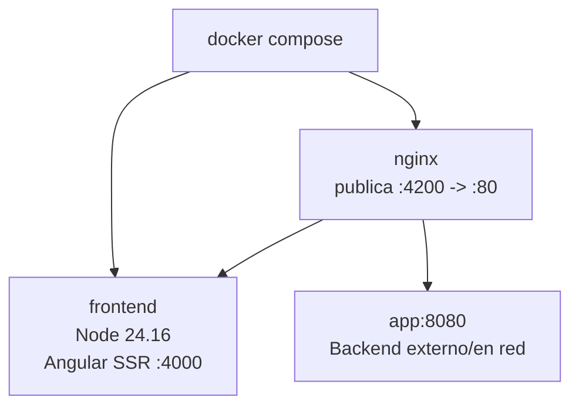

# Sismo Frontend

Frontend institucional para monitoreo, consulta y administracion sismologica del ICE. La aplicacion esta construida con Angular standalone, SSR, Tailwind CSS 4, mapas Leaflet, graficas Chart.js y una capa de API centralizada sobre `fetch`.

Este documento es la guia principal para entrega final: resume alcance, arquitectura, instalacion, rutas, despliegue, validacion y criterios de mantenimiento.

## Estado De Entrega

| Area | Estado |
|---|---|
| Framework | Angular 22 con componentes standalone |
| Renderizado | Angular SSR con rutas publicas server-side y rutas sensibles client-side |
| Estilos | Tailwind CSS 4 con tokens propios en `src/styles.css` |
| API | `ApiService` centralizado, JWT y soporte SSR con `SSR_API_URL` |
| Mapas | Leaflet inicializado solo en navegador |
| Calidad | ESLint, Vitest, build de produccion y build Docker en CI |
| Runtime | Node.js 24.16.0 y pnpm 10.32.1 |

## Stack

| Tecnologia | Version |
|---|---|
| Angular | 22.0.x |
| Angular SSR | 22.0.x |
| TypeScript | 6.0.x |
| Node.js | 24.16.0 |
| pnpm | 10.32.1 |
| Tailwind CSS | 4.3.x |
| RxJS | 7.8.x |
| Leaflet | 1.9.x |
| Chart.js | 4.5.x |
| Vitest | 4.1.x |

## Funcionalidad

- Monitoreo del ultimo evento sismico y estado de red.
- Consulta de sismos recientes e historicos con filtros.
- Visualizacion de mapas con epicentros, estaciones y leyenda por magnitud.
- Consulta de acelerografos, datos RSN, tablas y graficas.
- Administracion de estaciones, umbrales por estacion, repositorio de reportes y perfil tecnico.
- Autenticacion JWT para rutas administrativas.
- Exportacion y descarga de reportes desde el repositorio.
- Renderizado SSR para rutas publicas y carga client-side para rutas sensibles.

## Arquitectura General

```mermaid
flowchart LR
  user["Usuario / Navegador"] --> nginx["Nginx :80"]
  nginx -->|"/"| ssr["Angular SSR Node :4000"]
  nginx -->|"/api/**"| api["Backend Spring Boot :8080"]
  nginx -->|"/actuator/** interno"| actuator["Actuator Backend"]

  ssr --> browser["HTML inicial + assets"]
  browser -->|same-origin "/api/**"| nginx

  subgraph frontend["sismo-frontend"]
    ssr
    browser
  end
```

La aplicacion se sirve mediante Nginx como proxy inverso. Las rutas web pasan al servidor SSR de Angular y las rutas `/api/**` pasan al backend. En produccion el navegador usa mismo origen, mientras el servidor SSR usa `SSR_API_URL` para llamar al backend con URL absoluta.

## Flujo De Datos



Regla de mantenimiento: las paginas consumen servicios de dominio. No deben construir URLs ni manejar headers directamente.

## Rutas

| Ruta | Acceso | Render | Descripcion |
|---|---|---|---|
| `/` | Publico | Server | Inicio y resumen operativo |
| `/sismos` | Publico | Server | Analisis de eventos recientes |
| `/historial` | Publico | Server | Catalogo historico con filtros |
| `/estaciones` | Publico | Server | Red de estaciones acelerograficas |
| `/consultas` | Publico | Server | Consultas tecnicas, mapas y graficas |
| `/acceso` | Publico | Client | Login tecnico |
| `/recuperar-acceso` | Publico | Client | Recuperacion de acceso |
| `/cambiar-contrasena` | Publico | Client | Cambio de contrasena |
| `/umbrales-estaciones` | Admin | Client | Umbrales por estacion |
| `/repositorio` | Admin | Client | Reportes, CSV y documentos |
| `/profile` | Admin | Client | Perfil y usuarios autorizados |
| `/login` | Redireccion | - | Alias hacia `/acceso` |

Las rutas se definen en `src/app/app.routes.ts`. La politica SSR se centraliza en `src/app/routing/server-render-policy.ts`.



## Estructura

```text
src/
  app/
    components/       Componentes reutilizables
    guards/           Proteccion de rutas
    interceptors/     Interceptores Angular
    interfaces/       DTOs y contratos TypeScript
    pages/            Vistas lazy-loaded por ruta
    pipes/            Transformaciones de presentacion
    routing/          Politica SSR
    services/         Capa de API y dominio
    utils/            Reglas puras y helpers
  main.ts             Bootstrap browser
  main.server.ts      Bootstrap SSR
  server.ts           Servidor Angular SSR
  styles.css          Tailwind 4 y tokens visuales
public/               Activos estaticos
docs/                 Documentacion operativa
```

## Requisitos Locales

Usar exactamente las versiones declaradas en `package.json`, `.node-version` y `packageManager`.

```bash
node --version
# v24.16.0

pnpm --version
# 10.32.1
```

Activacion recomendada de pnpm:

```bash
corepack enable
corepack prepare pnpm@10.32.1 --activate
```

## Instalacion

```bash
git clone https://github.com/javier25arroyo/sismo-frontend.git
cd sismo-frontend
pnpm install --frozen-lockfile
```

Si `node_modules` fue creado con otra version de Node, reinstalar en limpio:

```bash
rm -rf node_modules .angular/cache
pnpm install --frozen-lockfile
```

En PowerShell:

```powershell
if (Test-Path node_modules) { Remove-Item -Recurse -Force node_modules }
if (Test-Path .angular\cache) { Remove-Item -Recurse -Force .angular\cache }
pnpm install --frozen-lockfile
```

## Desarrollo

```bash
pnpm start
```

La aplicacion queda disponible en `http://localhost:4200`. El backend local se espera en `http://localhost:8080`.

## Scripts

| Comando | Uso |
|---|---|
| `pnpm start` | Servidor de desarrollo |
| `pnpm build` | Build de produccion SSR |
| `pnpm watch` | Build en modo watch |
| `pnpm test` | Tests con Vitest |
| `pnpm lint` | Lint Angular/ESLint |
| `pnpm check` | Lint, tests sin watch y build |
| `pnpm security` | Auditoria de dependencias |
| `pnpm smoke:ssr:maps` | Smoke local de rutas SSR con mapas |

## Configuracion

| Archivo | Proposito |
|---|---|
| `src/environments/environment.ts` | API local para desarrollo |
| `src/environments/environment.prod.ts` | API same-origin para navegador en produccion |
| `SSR_API_URL` | URL absoluta del backend para renderizado SSR |
| `angular.json` | Build, SSR, budgets, allowed hosts y assets |
| `nginx.conf` | Proxy inverso a SSR y backend |
| `docker-compose.yml` | Orquestacion local de frontend SSR y Nginx |

## Despliegue

```bash
docker compose up -d --build
```

El compose publica Nginx en `http://localhost:4200` y mantiene el servidor SSR interno en `frontend:4000`.



Checklist de despliegue:

- `SSR_API_URL` apunta al backend accesible desde el contenedor SSR.
- `nginx.conf` resuelve `frontend:4000` y `app:8080` en la red Docker.
- `angular.json` incluye el host de produccion en `security.allowedHosts`.
- `pnpm check` pasa antes de construir imagen.
- `docker build -t sismo-frontend:ci .` pasa en CI.

Mas detalle en `docs/DESPLIEGUE.md`.

## Calidad Y CI

El workflow `.github/workflows/ci.yml` se ejecuta en push y pull request:

1. Checkout.
2. Setup pnpm.
3. Setup Node desde `.node-version`.
4. `pnpm install --frozen-lockfile`.
5. `pnpm check`.
6. `docker build -t sismo-frontend:ci .`.

Antes de entregar cambios:

```bash
pnpm check
docker build -t sismo-frontend:local .
```

## Convenciones De Desarrollo

- Mantener componentes standalone.
- Usar `ChangeDetectionStrategy.OnPush`.
- Usar `signal()`, `computed()` y `effect()` para estado local.
- No introducir `BehaviorSubject` para estado de componentes.
- Centralizar DTOs en `src/app/interfaces/api.interfaces.ts`.
- Usar `ApiService` para HTTP; no duplicar headers ni manejo de errores.
- Proteger Leaflet y APIs de navegador con `isPlatformBrowser`.
- Usar `AdminGuard` para rutas administrativas.
- Mantener estilos en Tailwind y tokens de `src/styles.css`.

## Documentacion Relacionada

| Documento | Uso |
|---|---|
| `docs/DESPLIEGUE.md` | Despliegue operativo y verificacion |
| `DEPLOY-SSR.md` | Arquitectura SSR y decisiones de despliegue |
| `DESIGN-SYSTEM.md` | Tokens visuales, componentes y reglas UI |
| `SIGNALS_MIGRATION.md` | Guia de reactividad con signals |
| `CLAUDE.md` | Reglas para agentes y mantenimiento tecnico |

## Licencia

Apache 2.0. Ver `LICENSE`.
