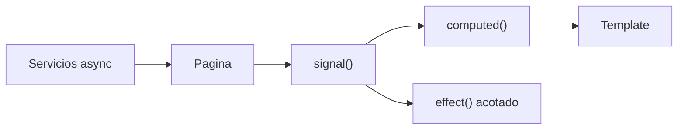
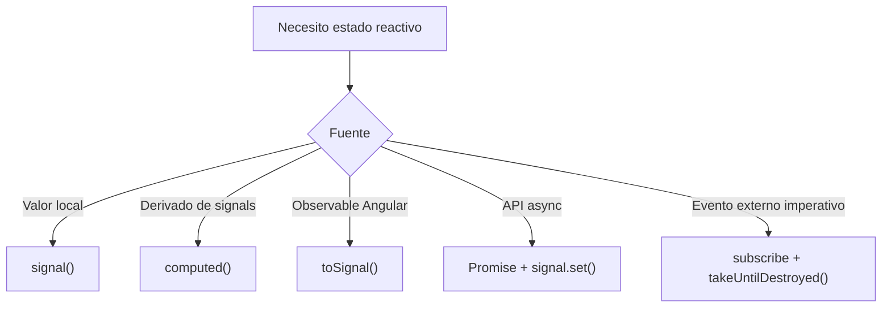

# Guia De Reactividad Con Signals

El frontend SISMO usa Angular signals como mecanismo principal de estado local. Este documento define el estado objetivo y las reglas para mantener una arquitectura reactiva simple, predecible y compatible con SSR.

## Objetivo

- Estado local explicito con `signal()`.
- Estado derivado con `computed()`.
- Efectos acotados con `effect()`.
- Servicios asincronos basados en `Promise` y `async/await`.
- Sin `BehaviorSubject` para estado de componentes.
- Sin suscripciones manuales salvo integracion puntual con APIs externas.



## Patron Recomendado En Paginas

```typescript
export class HistorialPage {
  eventos = signal<SismoRespuesta[]>([]);
  cargando = signal(false);
  filtro = signal('');

  eventosFiltrados = computed(() => {
    const texto = this.filtro().trim().toLowerCase();
    return texto
      ? this.eventos().filter(e => e.ubicacion.toLowerCase().includes(texto))
      : this.eventos();
  });

  async cargar(): Promise<void> {
    this.cargando.set(true);
    try {
      this.eventos.set(await this.sismoService.listar());
    } finally {
      this.cargando.set(false);
    }
  }
}
```

## Servicios

Los servicios de dominio deben envolver `ApiService` y devolver `Promise<T>`.

```typescript
@Injectable({ providedIn: 'root' })
export class SismoService {
  constructor(private api: ApiService) {}

  listarSismos(filtro: FiltroSismos): Promise<Page<SismoRespuesta>> {
    return this.api.get<Page<SismoRespuesta>>(this.buildPath(filtro));
  }
}
```

Reglas:

- No almacenar estado global en servicios salvo que sea una decision explicita.
- No exponer `Subject` o `BehaviorSubject` para estado de UI.
- No duplicar headers ni manejo de errores fuera de `ApiService`.

## Conversion De Observables

Usar `toSignal()` para Observables de Angular cuando el valor alimenta template o estado reactivo.

```typescript
const queryParams = toSignal(this.route.queryParams, {
  initialValue: {}
});

effect(() => {
  const id = queryParams()['id'];
  if (id) void this.cargar(id);
});
```

Usar `takeUntilDestroyed()` cuando una suscripcion manual sea la opcion mas clara, por ejemplo integraciones imperativas con APIs de terceros.

## SSR

Signals no eliminan la necesidad de proteger APIs del navegador.

```typescript
private readonly isBrowser = isPlatformBrowser(inject(PLATFORM_ID));

if (this.isBrowser) {
  // window, document, Leaflet, localStorage
}
```

Regla practica:

- Leaflet se inicializa solo en navegador.
- `localStorage` se accede via `AuthService` con guardas de plataforma.
- `fetch` en SSR usa URL absoluta via `SSR_API_URL`.

## Antipatrones

### BehaviorSubject Para UI

```typescript
// Evitar
private loadingSubject = new BehaviorSubject(false);
loading$ = this.loadingSubject.asObservable();
```

Usar:

```typescript
loading = signal(false);
```

### Estado Derivado Manual

```typescript
// Evitar
this.total.set(this.items().length);
```

Usar:

```typescript
total = computed(() => this.items().length);
```

### Suscripciones Sin Ciclo De Vida

```typescript
// Evitar
this.route.queryParams.subscribe(...);
```

Usar `toSignal()` o `takeUntilDestroyed()`.

## Decision De Uso



## Checklist De Revision

- [ ] El componente usa `ChangeDetectionStrategy.OnPush`.
- [ ] El estado mutable local usa `signal()`.
- [ ] Los valores derivados usan `computed()`.
- [ ] Los efectos tienen una razon clara y no reemplazan logica de template.
- [ ] Las llamadas HTTP viven en servicios.
- [ ] No hay `BehaviorSubject` nuevo para UI.
- [ ] Las suscripciones manuales tienen `takeUntilDestroyed()`.
- [ ] Las APIs de navegador estan protegidas para SSR.

## Archivos De Referencia

| Archivo | Uso |
|---|---|
| `src/app/services/api.service.ts` | API central y soporte SSR |
| `src/app/pages/historial/historial.page.ts` | Estado local con signals y computed |
| `src/app/pages/sismos/sismos.page.ts` | Integracion de rutas, SSR y mapas |
| `src/app/components/sismo-map/sismo-map.component.ts` | Guardas de plataforma para Leaflet |
| `src/app/routing/server-render-policy.ts` | Politica SSR por ruta |
