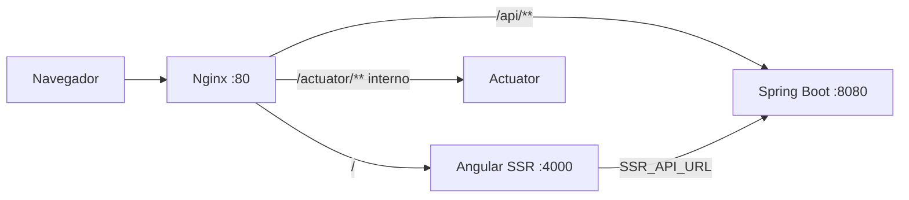
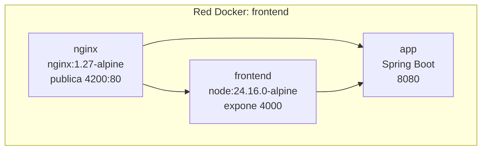
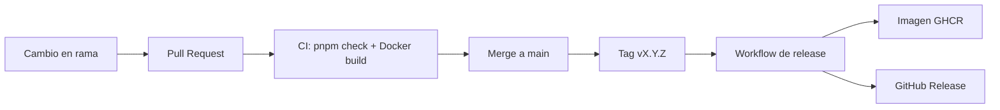

# Guia De Despliegue

Guia operativa para construir, configurar, desplegar y verificar `sismo-frontend` en modo Angular SSR detras de Nginx.

## Resumen

El frontend se despliega con dos servicios:

- `frontend`: contenedor Node.js que ejecuta Angular SSR en el puerto interno `4000`.
- `nginx`: proxy inverso que publica el sitio y enruta `/api/**` al backend.



## Requisitos

| Componente | Version | Uso |
|---|---|---|
| Node.js | 24.16.0 | Desarrollo, CI y runtime Docker |
| pnpm | 10.32.1 | Instalacion reproducible |
| Docker Engine | 24+ | Build y ejecucion containerizada |
| Docker Compose | v2 | Orquestacion local o servidor |

Validar versiones:

```bash
node --version
pnpm --version
docker --version
docker compose version
```

El proyecto debe ejecutarse con `node v24.16.0`. Versiones menores de Node 24, como `v24.0.0`, no cumplen el minimo requerido por Angular CLI 22.

## Variables De Entorno

| Variable | Servicio | Valor recomendado | Descripcion |
|---|---|---|---|
| `PORT` | `frontend` | `4000` | Puerto interno del servidor SSR |
| `SSR_API_URL` | `frontend` | `http://app:8080` | URL absoluta del backend desde Node SSR |
| `NODE_ENV` | build/runtime | `production` | Modo de ejecucion |

En el navegador, `environment.prod.ts` usa `apiUrl: ''` para llamar al mismo origen. En SSR, `ApiService` usa `SSR_API_URL` porque `fetch('/api/...')` no es valido en Node.

## Construccion Local

```bash
pnpm install --frozen-lockfile
pnpm check
pnpm build
```

La build genera artefactos SSR bajo:

```text
dist/sismo-frontend/
  browser/
  server/
```

## Docker

Construir imagen:

```bash
docker build -t sismo-frontend:local .
```

Levantar stack:

```bash
docker compose up -d --build
```

Ver logs:

```bash
docker compose logs -f frontend
docker compose logs -f nginx
```

Detener:

```bash
docker compose down
```

## Servicios Docker



El archivo `docker-compose.yml` incluido espera que el backend sea resoluble como `app:8080` dentro de la misma red. Si el backend tiene otro nombre de servicio, ajustar `SSR_API_URL` y el upstream `backend` en `nginx.conf`.

## Nginx

`nginx.conf` cumple cuatro responsabilidades:

1. Reenviar rutas web al servidor SSR (`frontend:4000`).
2. Reenviar `/api/**` al backend (`app:8080`).
3. Restringir `/actuator/**` a redes internas.
4. Aplicar cabeceras de seguridad y gzip.

No se define CSP como cabecera Nginx porque Angular genera CSP con `autoCsp` durante la build. Agregar otra CSP en Nginx podria crear conflicto.

## Allowed Hosts

Angular SSR valida el header `Host`. En `angular.json` existe:

```json
"security": {
  "allowedHosts": ["localhost"]
}
```

Para produccion, agregar el dominio real:

```json
"security": {
  "allowedHosts": ["localhost", "sismologia.ice.go.cr"]
}
```

Sin este cambio, el servidor SSR puede responder `400 Bad Request` en dominios no autorizados.

## Verificacion

Verificar Nginx:

```bash
curl -i http://localhost:4200/
```

Verificar SSR interno:

```bash
docker compose exec frontend wget -q -O - http://127.0.0.1:4000/ | head
```

Verificar proxy API:

```bash
curl -i http://localhost:4200/api/actuator/health
```

Verificar rutas con mapas:

```bash
pnpm smoke:ssr:maps
```

Verificacion minima antes de entrega:

```bash
pnpm check
docker build -t sismo-frontend:ci .
```

## Flujo De Release



El workflow de release se activa con tags `vX.Y.Z`. Construye la imagen, publica en GHCR y crea o actualiza el release de GitHub.

## Problemas Comunes

### Angular CLI rechaza la version de Node

Instalar Node `24.16.0`, abrir una terminal nueva y reinstalar dependencias.

```bash
rm -rf node_modules .angular/cache
pnpm install --frozen-lockfile
```

### SSR no llega al backend

Revisar `SSR_API_URL` dentro del contenedor:

```bash
docker compose exec frontend env | grep SSR_API_URL
```

El valor debe ser accesible desde el contenedor `frontend`, no necesariamente desde el navegador.

### El navegador no llega a la API

Revisar Nginx:

- `location /api/` existe.
- `proxy_pass http://backend;` apunta al upstream correcto.
- El backend esta en la misma red Docker o el hostname resuelve.

### Rutas con mapa fallan durante SSR

Leaflet no debe ejecutarse en servidor. Revisar que cualquier uso de `window`, `document` o `L.map()` este protegido con `isPlatformBrowser`.

### Host de produccion devuelve 400

Agregar el dominio a `security.allowedHosts` en `angular.json` y reconstruir la imagen.

## Checklist Final

- [ ] `node --version` muestra `v24.16.0`.
- [ ] `pnpm install --frozen-lockfile` termina sin modificar lockfile.
- [ ] `pnpm check` pasa.
- [ ] `docker build -t sismo-frontend:ci .` pasa.
- [ ] `SSR_API_URL` apunta al backend correcto.
- [ ] `allowedHosts` incluye el dominio final.
- [ ] `/`, `/sismos`, `/historial`, `/estaciones` y `/consultas` responden 200.
- [ ] `/api/**` responde desde el backend via Nginx.
- [ ] Las rutas administrativas cargan en modo client-side.
